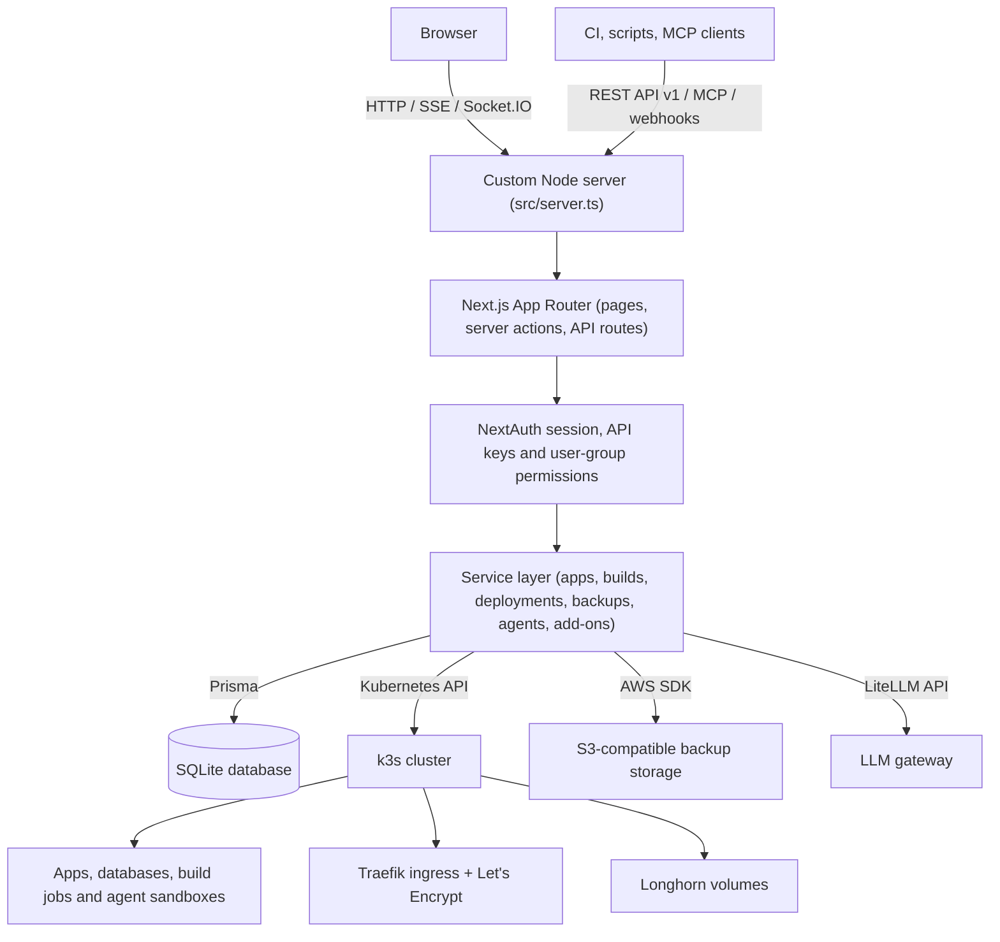

# StackPilot

StackPilot is an open-source, self-hosted Platform-as-a-Service (PaaS) for building, deploying and managing containerized applications, databases and AI agent sandboxes on your own k3s cluster.

## What This Project Does

Running apps on your own bare-metal servers or VMs usually means stitching together Kubernetes manifests, ingress controllers, certificates, storage and backup jobs by hand. StackPilot puts a web dashboard and a control plane on top of a lightweight k3s cluster so that a small team can do all of this from one place.

### Key Features
- **Application deployments**: Deploy apps from public or private Git repositories (HTTPS or SSH deploy keys) or from container images. Images are built inside the cluster with a Dockerfile, Railpack or JavaScript framework presets (Next.js, Nuxt, Astro, SvelteKit, Angular, React).
- **Templates**: One-click PostgreSQL, MySQL, MariaDB, MongoDB and Redis databases plus dozens of popular self-hosted apps (Gitea, n8n, Grafana, Nextcloud, WordPress and more).
- **Domains and networking**: Traefik ingresses with Let's Encrypt certificates, HTTPS redirects, HTTP basic auth, node ports, wildcard DNS hostnames and per-app network policies with an interactive project network graph.
- **Storage and backups**: Longhorn volumes with selectable storage classes, shared volumes, config file mounts, scheduled volume and native database backups to S3-compatible storage, restore and pre-deployment backups.
- **AI agent sandboxes**: Run coding agents created from harness templates in isolated sandboxes (optionally with the gVisor runtime), connected to a LiteLLM gateway, with their own domains, volumes, environment variables and egress rules.
- **Operations**: Live build and container logs, a web terminal, CPU/memory/disk monitoring, Kubernetes events, health checks, rollbacks, platform updates, k3s upgrades and cluster add-on management.
- **Team access**: Users and user groups with project, app and agent permissions, TOTP two-factor authentication, SSO providers (GitHub, Google, Microsoft Entra) and API-only users.
- **Automation**: Personal API keys, a versioned REST API with OpenAPI docs, deploy webhooks and a Model Context Protocol (MCP) endpoint.

## How It Works

StackPilot is a Next.js application served by a custom Node.js server that also hosts a Socket.IO endpoint for web terminal sessions. Server actions and API routes call a service layer that stores configuration in SQLite through Prisma and reconciles it into Kubernetes objects with the official Kubernetes client.



### Main Flow
1. **User action**: An operator creates or changes a project, app or agent in the dashboard (or through the REST API / MCP).
2. **Validation and persistence**: The request is authenticated, checked against the user's group permissions, validated with Zod schemas and stored with Prisma.
3. **Build**: For Git sources a Kubernetes build job clones the repository and pushes the image to the registry inside the cluster.
4. **Reconciliation**: The deployment services create or update namespaces, Deployments, Services, Secrets, PVCs, ingresses and network policies.
5. **Live feedback**: Build status, pod status and logs stream back to the browser over HTTP streams and server-sent events; terminal sessions use Socket.IO.

## Project Structure

```text
├── .devcontainer/              # Dev container with a local k3s cluster
├── .github/                    # CI workflows (tests, release and canary images) and issue templates
├── additional-containers/      # Helper images for PostgreSQL, MariaDB/MySQL and MongoDB backups
├── docs/                       # Architecture decision records, agent domain notes and research
├── github-assets/              # Images used in the repository presentation
├── prisma/                     # Prisma schema and SQL migrations
├── public/                     # Static assets: logos, template icons, framework logos, manual videos
├── scripts/                    # Generators for Kubernetes CRD and LiteLLM OpenAPI client types
├── setup/                      # Shell scripts to install k3s, Longhorn and StackPilot on a server
└── src/
    ├── __tests__/              # Test helpers and integration tests
    ├── app/                    # Next.js App Router pages, layouts, server actions and API routes
    ├── components/             # shadcn/ui primitives and custom reusable components
    ├── frontend/               # Client hooks, state stores, SSE/socket clients and UI utilities
    ├── server/
    │   ├── adapter/            # Clients for Kubernetes, Longhorn, registry, S3, LiteLLM and agent sandboxes
    │   ├── api/                # Elysia-based REST API v1 route modules
    │   ├── mcp/                # Model Context Protocol server and operation registry
    │   ├── services/           # Business logic: apps, builds, deployments, backups, agents, add-ons
    │   └── utils/              # Server utilities: auth options, action wrapper, crypto, path helpers
    ├── shared/
    │   ├── model/              # Zod models, including schemas generated from Prisma
    │   ├── templates/          # App, database and agent harness templates
    │   └── utils/              # Utilities shared by client and server
    ├── middleware.ts           # Route protection for authenticated pages
    ├── server.ts               # Custom HTTP server that starts Next.js, Socket.IO and background jobs
    └── socket-io.server.ts     # Socket.IO server for web terminal sessions
```

## Tech Stack

| Layer | Technology | Purpose |
|---|---|---|
| Web framework | Next.js `^14.2.1`, React `^18.2.0` | App Router UI, server actions and API routes |
| Language | TypeScript `^5.4.5` | Typed code for client and server |
| Styling and UI | Tailwind CSS via `@tailwindcss/postcss` `^4.3.3`, shadcn `^4.21.0`, Base UI `^1.8.0`, Lucide React `^0.368.0` | Design system, components and icons |
| Graphs and charts | `@xyflow/react` `^12.10.0`, elkjs `^0.9.2`, Recharts `2.12.5` | Project network graph layout and monitoring charts |
| Client state and forms | Zustand `^4.5.2`, React Hook Form `^7.51.3` | Global UI state and form handling |
| REST API | Elysia `^1.0.13`, `@elysiajs/openapi` `^1.4.15` | Versioned REST API with OpenAPI documentation |
| MCP | `@modelcontextprotocol/server` `^2.3.0` | Model Context Protocol endpoint |
| Dependency injection | TypeDI `^0.10.0` | Service wiring on the server |
| Database and ORM | Prisma `5.12.1`, SQLite | Schema, migrations and data access |
| Validation | Zod `3.22.4`, zod-prisma `^0.5.4` | Runtime validation and generated model schemas |
| Authentication | NextAuth `^4.24.7`, bcrypt `^5.1.1`, otpauth `^9.2.3` | Sessions, password hashing, SSO and TOTP 2FA |
| Kubernetes | `@kubernetes/client-node` `^0.20.0` | Managing workloads on the k3s cluster |
| Git | simple-git `^3.24.0` | Repository access for builds |
| Object storage | `@aws-sdk/client-s3` `^3.554.0` | Backups to S3-compatible storage |
| Real-time | Socket.IO `^4.7.5`, xterm.js `^5.5.0` | Web terminal connections and rendering |
| Scheduling | node-schedule `^2.1.1`, cron-parser `^4.9.0` | Backup and maintenance jobs |
| Testing | Vitest `^1.5.0`, Testing Library `^15.0.2`, `@testcontainers/k3s` `^11.14.0` | Unit and integration tests |

## How to Run This Project

### Prerequisites
- **Node.js** 22 (the version used by the Docker image)
- **Yarn** 1.22 (declared in `packageManager`; npm works as well)
- **Git**
- **Docker** - for building the image and for the integration tests that start a k3s test container
- **A k3s cluster** - required for anything that creates workloads. In development the app reads its kubeconfig from `/workspace/kube-config.config` (the path used by the dev container); see [CONTRIBUTING.md](CONTRIBUTING.md) for connecting to a remote cluster.

### 1. Clone the Repository
```bash
git clone https://github.com/jawaddev921-afk/stackpilot.git
cd stackpilot
```

### 2. Install Dependencies
```bash
yarn install
```
The repository does not ship a lockfile, so the newest versions matching the ranges in `package.json` are installed.

### 3. Environment Variables
Copy the template and adjust the values:
```bash
cp .env.example .env
```

| Variable | Description | Example |
|---|---|---|
| `DATABASE_URL` | SQLite connection string used by Prisma | `file:./dev.db` |
| `NEXTAUTH_SECRET` | Secret for signing sessions and tokens; use a long random string | `change-this-to-a-secure-random-secret` |
| `NEXTAUTH_URL` | Public URL of the dashboard; also used to check the origin of terminal connections | `http://localhost:3000` |
| `PORT` | Port of the custom Node server | `3000` |
| `NODE_ENV` | `development` or `production` | `development` |
| `START_MODE` | Only used when `NODE_ENV=production`: `setup` bootstraps the cluster, `reset-password` resets the admin password, any other value starts the server | `server` |
| `K3S_JOIN_TOKEN` | Optional (production): token saved at startup and shown when adding cluster nodes | *(empty)* |
| `AGENT_ACCESS_TOKEN_TTL_SECONDS` | Lifetime of access tokens for agent sandboxes (defaults to 60 in code) | `3600` |
| `AUTH_PROXY_DEBUG_ENABLED` | Enables debug logging in the agent auth proxy | `false` |
| `KUBECONFIG`, `KUBECTL_PATH` | Only read by the optional live gVisor integration test (`RUN_GVISOR_LIVE_INTEGRATION=1`) | *(empty)*, `kubectl` |

### 4. Database Setup
Generate the Prisma client and Zod schemas, then apply the migrations:
```bash
yarn prisma-generate
yarn prisma-deploy
```
After changing `prisma/schema.prisma`, create a new migration with `yarn prisma-migrate`.

### 5. Run
Start the custom server, which also runs the Socket.IO terminal endpoint and the background backup and maintenance jobs:
```bash
yarn dev-live
```
`yarn dev` starts the plain Next.js dev server with hot reload, but without the Socket.IO server. Open [http://localhost:3000](http://localhost:3000); the first visitor registers the admin account.

Production build:
```bash
yarn build
yarn start-prod
```

### 6. Run Tests
```bash
yarn test
```
Other variants: `yarn test:watch`, `yarn test:ui` and `yarn test:coverage`. Tests in `src/__tests__/integration` run in a Node environment and some of them start a k3s test container, so Docker must be running.

### 7. Docker
Build the image:
```bash
docker build --build-arg VERSION_ARG=dev -t stackpilot:dev .
```
The image runs `yarn start-prod`, applies database migrations at startup and talks to Kubernetes with in-cluster credentials, so it is meant to run inside the k3s cluster rather than as a standalone container. On a fresh Linux server, [`setup/setup.sh`](setup/setup.sh) installs k3s and Longhorn and deploys StackPilot as a Kubernetes job and deployment.

## License

StackPilot is licensed under the GPL-3.0 license. See [LICENSE](LICENSE).
